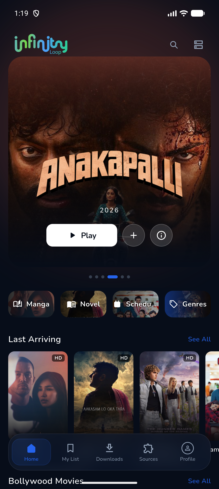
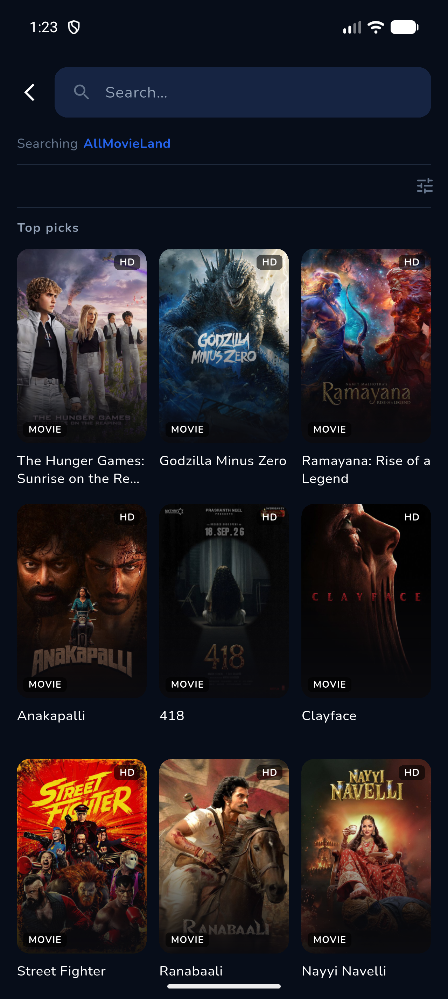
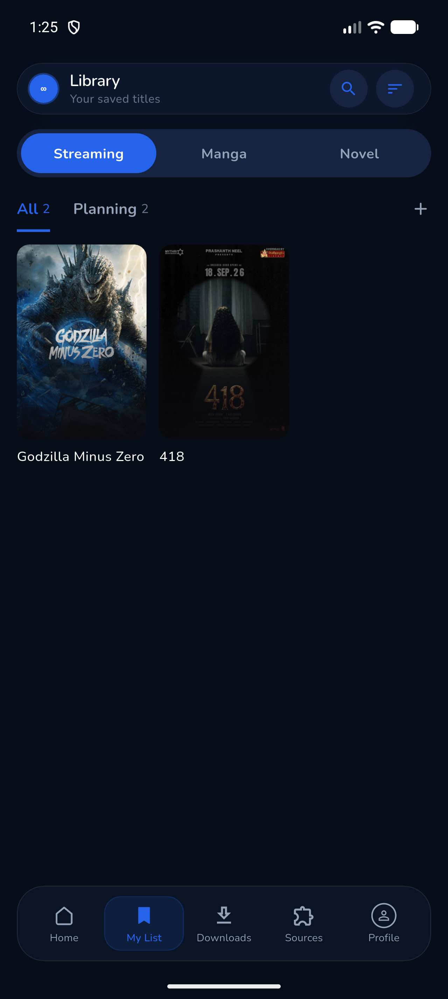

### A modern, open-source streaming app & offline downloader for movies, anime, manga & light novels — Android, TV and iOS

 

 

&nbsp;

  

  <a href="#-features"><b>Features</b></a> ·
  <a href="#-screenshots"><b>Screenshots</b></a> ·
  <a href="#-tech-stack"><b>Tech Stack</b></a> ·
  <a href="#-developer--contact"><b>Developer</b></a> ·
  <a href="#-license"><b>License</b></a>

## 🎬 Features

* **High Performance Streaming & Player:** Powered by ExoPlayer and MediaKit with full hardware decoding, custom subtitle styling, playback speed control, and swipe gestures.
* **Smart Offline Downloader:** 
  * Direct movie downloads without redundant episode wrappers.
  * Real-time network speed monitor (`MB/s` / `KB/s`), downloaded vs total file size, and dynamic ETA.
  * Multi-connection HLS & MP4 segmented downloading with instant pause and resume checkpoints.
  * One-touch Pause, Resume, and Cancel buttons directly on download cards.
  * Long-press multi-selection mode with batch deletion.
* **Manga & Novel Reader:** Dedicated reader interface with continuous vertical scroll, chapter bookmarking, and offline caching.
* **Android TV Ready:** Dedicated 10-foot remote D-Pad navigation UI built from the ground up for big screens.
* **Rich Personalization & Theming:** Custom app icons, splash animation selector, custom image uploads, pure AMOLED black mode, and customizable accent colors.
* **Watch History & Sync:** Automatic progress tracking, resume markers, and cross-source metadata integration.

---

## 📸 Screenshots

<table>
<tr>
<td align="center">

 <b>🏠 Home</b>
</td>
<td align="center">

 <b>🔍 Search</b>
</td>
<td align="center">

 <b>📄 Details</b>
</td>
<td align="center">

 <b>📋 My List</b>
</td>
</tr>
</table>

---

## 🛠️ Tech Stack

* **Framework:** Flutter (Dart 3.x)
* **Media Playback:** ExoPlayer (Android Native) & MediaKit
* **State Management:** BLoC / Cubit & ValueNotifier
* **Storage:** Hive (NoSQL Local Database) & PathProvider
* **Networking:** Dio, Http, Custom Segment Downloader
* **Image Caching:** CachedNetworkImage

---

## 👨‍💻 Developer & Contact

Developed and maintained by **S. M. Shahin Reza Sifat** (Founder of Motion Work).

### **S. M. Shahin Reza Sifat**
*Software Developer & Founder of Motion Work*

 

---

## 📜 License

Copyright © 2026 **S. M. Shahin Reza Sifat / Motion Work**

Licensed under the **[GNU GPL-3.0](LICENSE)**. See the included license file for complete terms.

 

### Zangetsu
*Crafted with ❤️ for entertainment lovers.*

 

