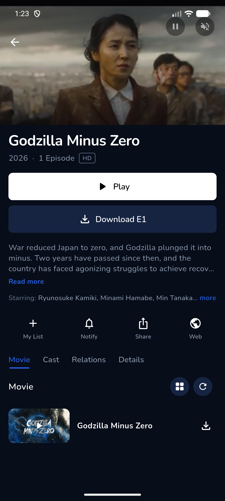
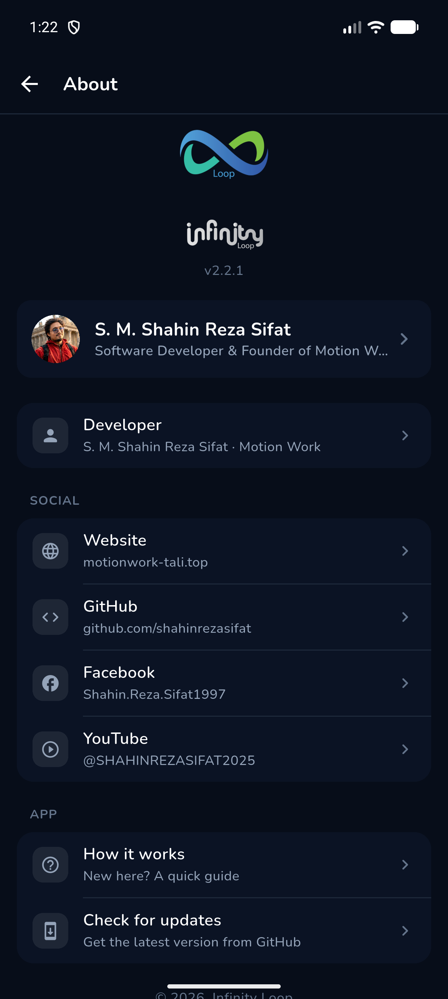
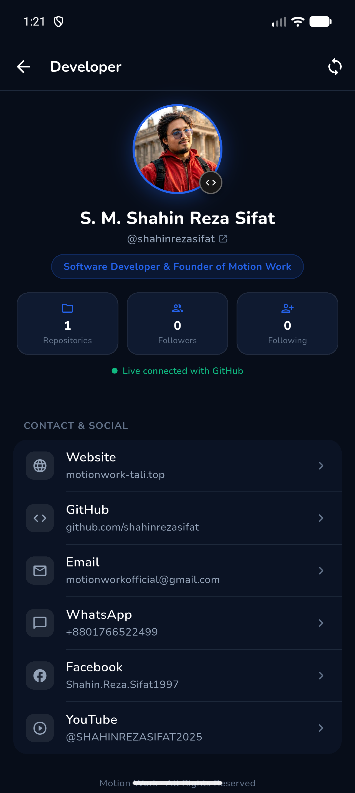

  
  <h1>Infinity Loop</h1>
  
<strong>Android streaming app and Android TV app for anime, movies, TV series, manga, and light novels.</strong>

  

    
    
    
    
    
  

  

    
  

Infinity Loop is an independently maintained, modified open-source Android and Android TV app that combines a video player, an offline download manager, and dedicated manga and light novel readers. Watch supported streams, save media for offline use, and add your own streams or M3U playlists through Link Repo. On Android TV, browse and control playback with a D-pad remote.

## Screenshots

Infinity Loop v2.2.1 running on the Android Studio emulator.

<table>
  <tr>
    <td align="center"> <strong>Home</strong></td>
    <td align="center"> <strong>Search</strong></td>
  </tr>
  <tr>
    <td align="center"> <strong>Details</strong></td>
    <td align="center"> <strong>My List</strong></td>
  </tr>
  <tr>
    <td align="center"> <strong>About &amp; Updates</strong></td>
    <td align="center"> <strong>Developer</strong></td>
  </tr>
</table>

## Features

| Feature | What you can do |
| --- | --- |
| **Streaming** | Browse and search movies, TV series, and anime from enabled sources. Open title details, choose an episode or stream, and resume from your saved position. |
| **Smart video player** | Choose available quality, audio, and subtitles. Adjust speed and subtitle styling, use picture-in-picture or Cast on supported devices, and skip anime openings, recaps, endings, or filler when skip data is available. |
| **Offline download manager** | Download supported movies and episodes, see progress, speed, and estimated time remaining, and pause, resume, or cancel from the download card. Select multiple downloads for deletion and play completed downloads offline. |
| **M3U playlists and Link Repo** | Save your own direct streams, M3U playlists, and website links. Open compatible media links in the built-in player. |
| **Manga and light novel reader** | Switch between dedicated reading modes, adjust layout or typography, track chapter progress, and download supported chapters. Export downloaded novel chapters to EPUB. |
| **Watch Party** | Sign in to host a room or join with a code and follow the host's playback. |
| **Library and trackers** | Organize titles in My List, revisit your watch history, and connect AniList, MyAnimeList, Simkl, or MangaBaka to sync supported activity. |
| **Appearance and personalization** | Set an AMOLED black theme, choose accent colors and fonts, change the app icon and splash animation, and arrange Home rows and navigation tabs. |
| **Backup and Incognito** | Back up supported app data to a file or to your signed-in account. Use Incognito to pause search and watch history recording and tracker updates. |
| **Android TV interface** | Navigate Home, Search, title details, downloads, and playback with a D-pad remote on the dedicated TV interface. |

Available titles, streams, subtitles, and download options depend on the enabled source. See the [source repository guide](REPOSITORIES.md) for provider setup.

## Infinity Loop customizations

S. M. Shahin Reza Sifat maintains this fork under **Motion Work**. Infinity Loop adds its own launcher icon, startup visuals and developer profile, a Link Repo for user-supplied media links, and an updated download interface with on-card controls, transfer statistics, and resume checkpoints.

## Installation

1. Open [Latest Release](https://github.com/shahinrezasifat/infinity-loop/releases/latest) and download the APK listed under **Assets**.
2. Open the APK on your Android phone or transfer it to your Android TV and open it with a file manager. If prompted, allow that installer to install from its source.
3. Launch Infinity Loop, choose **Streaming**, **Manga**, or **Novel**, and configure a supported source or add a media link.

## App updates

On Android and Android TV, Infinity Loop checks this repository for new stable releases when it starts or returns to the foreground. You can also check from **Settings → About → Check for updates**. Choose **Update** to download the verified APK and open Android's installer. Android requires installation confirmation and may ask you to allow installs from Infinity Loop the first time.

To publish an update, increase the app version and Android build number, sign with the same Infinity Loop release key, and publish a stable GitHub release tagged vX.Y.Z with an APK named Infinity-Loop-vX.Y.Z-universal.apk.

Version 2.2.1 uses the new Android application ID com.motionwork.infinityloop. Older builds use a different Android identity. Install the new APK separately. Its app data starts fresh.

Cloud sync, account-based Watch Party, tracker sign-in and Discord presence require the maintainer's own service configuration. This APK supports local use without those accounts.

## License

Infinity Loop is maintained by [S. M. Shahin Reza Sifat](https://github.com/shahinrezasifat/) at Motion Work. See [NOTICE.md](NOTICE.md) for source and dependency notices.

Infinity Loop is distributed under the [GNU General Public License v3.0](LICENSE).
